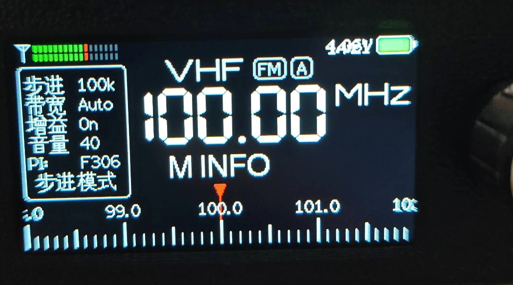

# ATS-Mini 中文固件 · ATS-Mini Chinese Firmware

**简体中文** ｜ [English](#english)



> 照片为 v1 版本，顶栏电压与电池图标的重叠问题已在后续版本修复。

---

## 中文

### 这是什么

这是 [esp32-si4732/ats-mini](https://github.com/esp32-si4732/ats-mini) 的**中文定制固件**，为 Sunnygold 设计的 ESP32-S3 + Si4732 全波段口袋收音机而编译。

只做三件事：**界面汉化**、**交互优化**、**显示修正**。射频前端、DSP 解调、扫台与 RDS 解析算法全部沿用上游，不做原理性改动。

### 硬件

| 项 | 规格 |
|---|---|
| 主控 | ESP32-S3 N16R8（16 MB Flash / 8 MB Octal PSRAM） |
| 收音芯片 | Si4732-A10（FM / AM / LW / 短波，SSB 依赖 DSP 补丁） |
| 屏幕 | 1.9" IPS **170×320**，ST7789P3，8080 八位并口 |
| 输入 | EC11 旋转编码器（带按压），无蜂鸣器 |
| 天线 | 镀金 SMA 母座 |
| 其他 | 3.5 mm 耳机、喇叭座、锂电池焊盘、USB-C（仅用于烧写与远程控制） |

### 相对上游的改动

| # | 改动 | 涉及文件 |
|---|---|---|
| 1 | **中文字体渲染**：使用 LovyanGFX 自带的 `lgfx_efont_cn`（16 px / 24 px）。该字库带 Unicode 映射表，**UTF-8 源码可直接显示中文**，无需转 GB2312。纯 ASCII 文本自动回落到原字体，数字与单位视觉完全不变 | `CnFont.h`（新增） |
| 2 | **界面汉化**：主菜单 14 项、设置菜单 22 项、信息栏 7 个标签 | `Menu.cpp` |
| 3 | **按键手势重映射**：见下方手势表 | `ats-mini.ino` / `Menu.cpp` |
| 4 | **搜索模式**：旋钮不再按步长调谐，而是直接跳台，复用 SI4732 芯片原生 seek | `ats-mini.ino` |
| 5 | **模式指示**：信息栏第三行由时钟改为「步进模式 / 搜索模式」，搜索态蓝底高亮 | `Menu.cpp` |
| 6 | **RDS 台名容错**：只接受 0A 组（排除 0B 混入错字）、PI 变化即清空累积、3 秒超时重来、四段允许乱序收齐 | `SI4735-fixed.h` |
| 7 | **顶栏时钟**：显示在电池电压左侧，按实测文字宽度自动避让；Wi-Fi 图标亮起时继续左移 | `Layout-Default.cpp` / `Battery.cpp` |
| 8 | **日期时间页修正**：上游把逻辑写反了（短按=保存退出、长按=切字段）。改为**单击切下一字段、长按保存退出**，并新增 `clickLongPress()` 保证退出前落盘 | `Menu.cpp` / `Menu.h` / `ats-mini.ino` |
| 9 | **台名滚动**：台名宽度超过 96 px（4 个汉字）时，用裁剪窗口循环左右滚动，3 帧/秒 | `Draw.cpp` / `Draw.h` |
| 10 | **默认自动熄屏**：`DEFAULT_SLEEP` 由 0（关闭）改为 30 秒 | `ats-mini.ino` |

### 按键手势

| 手势 | 判定 | 主界面 | 音量页 | 菜单 / 子页面 |
|---|---|---|---|---|
| 单击 | < 0.5 s | 打开音量 | 退出 | 进入 / 确认 |
| 中按 | 0.5–2 s | 切换 步进 ⇄ 搜索 | 进入 | 进入 |
| 长按 | > 2 s | 无动作 | **静音切换** | 退出（日期时间页会先保存） |
| 双击 | 间隔 < 0.4 s | 打开主菜单 | — | — |
| 转动 | — | 步进调谐 / 搜索模式跳台 | 调音量 | 选项上下移动 |
| 按住 + 转 | — | 频率逐位输入 | — | — |

完整表格见 [docs/keymap-zh.md](docs/keymap-zh.md)。

### 有意保留英文的部分

以下内容**不翻译**，因为它们是国际通用的行业标识，翻译反而看不懂：

- 波段名：`11M` `49M` `MW1` `VHF` …
- 模式：`FM` `AM` `LSB` `USB`
- 单位：`MHz` `kHz` `dB` `dBuV`
- 状态值：`Auto` `On` `Hold`
- RDS 的 `PI` 码、`VFO`、`AGC` 缩写本身

### 编译

工具链版本由 `ats-mini/sketch.yaml` 锁定，用 Arduino CLI 的 profile 模式可直接还原：

```bash
arduino-cli compile --profile esp32s3-ospi --output-dir build ats-mini
```

| 依赖 | 版本 |
|---|---|
| esp32 core | 3.3.12 |
| FQBN | `esp32:esp32:esp32s3:CDCOnBoot=cdc,FlashSize=8M,PSRAM=opi,CPUFreq=80,USBMode=hwcdc,FlashMode=qio,PartitionScheme=custom,DebugLevel=none` |
| PU2CLR SI4735 | 2.1.8 |
| LovyanGFX | 1.2.33 |
| Async TCP | 3.5.0 |
| ESP Async WebServer | 3.12.1 |

编译产物约 **2.67 MB**，占用 3 MB 的 app 分区。

### 烧写

**第一步永远是备份**（16 MB 整片，出问题能原样刷回）：

```bash
esptool.py --port COM7 read-flash 0 0x1000000 flash_backup.bin
```

进入下载模式：**按住 BOOT → 点一下 RESET → 松开 BOOT**。

```bash
esptool.py --port COM7 write-flash -z --flash-mode keep --flash-freq keep --flash-size keep \
  0x0     build/ats-mini.ino.bootloader.bin \
  0x8000  build/ats-mini.ino.partitions.bin \
  0xE000  boot_app0.bin \
  0x10000 build/ats-mini.ino.bin
```

> `boot_app0.bin` 不在编译产物里，可从上游 Release 包或 Arduino ESP32 core 中取得。

### 开发笔记

- **不要改 `Common.h`**。它被所有 `.cpp` 包含，改一行就触发全量重编（约 9 分钟）。需要跨文件共享变量时，在 `Battery.cpp` 这类文件里定义非 static 全局量，在使用处用**函数内 `extern`** 声明。
- `Button::isLongPressed` 是**电平语义**（按住期间每轮循环都为真），必须加边沿锁存，否则会连续触发。
- 台名滚动的触发条件是「实测宽度 > 96 px」，不是字符数；8 个英文字符通常不会触发。

### 已验证硬件

Sunnygold 开源硬件（ESP32-S3-N16R8 + Si4732-A10 + ST7789 170×320 + EC11），香港地区实测 FM / 短波接收正常。

---

## English

### What this is

A **Chinese-localized firmware** for [esp32-si4732/ats-mini](https://github.com/esp32-si4732/ats-mini), built for the Sunnygold ESP32-S3 + Si4732 pocket shortwave receiver.

Only three things are changed: **UI localization**, **interaction tweaks**, and **display fixes**. The RF front end, DSP demodulation, seek and RDS parsing algorithms are inherited from upstream unchanged.

### Key changes over upstream

| # | Change |
|---|---|
| 1 | **CJK rendering** via LovyanGFX's bundled `lgfx_efont_cn` (16 px / 24 px). The font ships a Unicode mapping table, so **UTF-8 literals render directly** — no GB2312 conversion needed. Pure-ASCII strings fall back to the original font, keeping digits and units pixel-identical |
| 2 | **UI localization**: main menu (14 items), settings menu (22 items), info-panel labels |
| 3 | **Remapped key gestures** (single / medium / long / double click) |
| 4 | **Search mode**: turning the encoder jumps to the next station using the Si4732 native seek instead of stepping |
| 5 | **Mode indicator** replaces the clock in the info panel third row |
| 6 | **RDS PS tolerance**: accept group 0A only (filters 0B corruption), clear the buffer when PI changes, 3-second timeout, out-of-order segment assembly |
| 7 | **Top-bar clock** placed left of the battery voltage, auto-clearance based on measured text width |
| 8 | **Date/time editor fix**: upstream had it inverted (short press saved and exited). Now single click advances the field, long press saves and exits, with a dedicated `clickLongPress()` so edits are never dropped |
| 9 | **Station-name marquee** with a 96 px clipping window at 3 fps |
| 10 | **Auto screen blank** default changed from off to 30 s |

### Gestures

| Gesture | Main screen | Volume | Menu / sub-page |
|---|---|---|---|
| Click (< 0.5 s) | Volume | Exit | Enter / confirm |
| Medium press (0.5–2 s) | Toggle step ⇄ search | Enter | Enter |
| Long press (> 2 s) | — | Mute toggle | Exit (date/time saves first) |
| Double click | Main menu | — | — |
| Rotate | Tune / jump to next station | Volume | Move selection |
| Hold + rotate | Digit-by-digit frequency entry | — | — |

### Deliberately left in English

Band names (`11M`, `49M`, `VHF`), modes (`FM`, `AM`, `LSB`, `USB`), units (`MHz`, `kHz`, `dB`), state values (`Auto`, `On`, `Hold`), the RDS `PI` code, `VFO` and `AGC` — these are industry-standard identifiers where translation would only confuse.

### Build

```bash
arduino-cli compile --profile esp32s3-ospi --output-dir build ats-mini
```

The toolchain is pinned in `ats-mini/sketch.yaml`: esp32 core **3.3.12**, PU2CLR SI4735 **2.1.8**, LovyanGFX **1.2.33**, Async TCP **3.5.0**, ESP Async WebServer **3.12.1**.

### Flash

Always back up the full 16 MB flash first, then enter download mode by **holding BOOT, tapping RESET, releasing BOOT**:

```bash
esptool.py --port COM7 read-flash 0 0x1000000 flash_backup.bin
esptool.py --port COM7 write-flash -z --flash-mode keep --flash-freq keep --flash-size keep \
  0x0     build/ats-mini.ino.bootloader.bin \
  0x8000  build/ats-mini.ino.partitions.bin \
  0xE000  boot_app0.bin \
  0x10000 build/ats-mini.ino.bin
```

### Notes for hackers

- **Do not touch `Common.h`** — every translation unit includes it, so a single edit forces a full 9-minute rebuild. Define non-static globals where they belong (e.g. `Battery.cpp`) and use a block-scope `extern` at the point of use.
- `Button::isLongPressed` is level-triggered, not edge-triggered; latch it or it will fire every loop iteration.
- The marquee triggers on measured pixel width (> 96 px), not character count.

---

## Credits / 致谢

This project is a derivative of [esp32-si4732/ats-mini](https://github.com/esp32-si4732/ats-mini), which in turn builds on:

- Volos Projects — https://github.com/VolosR/TEmbedFMRadio
- PU2CLR, Ricardo — https://github.com/pu2clr/SI4735
- Ralph Xavier — https://github.com/ralphxavier/SI4735
- Goshante — https://github.com/goshante/ats20_ats_ex
- G8PTN, Dave — https://github.com/G8PTN/ATS_MINI
- Sunnygold — open hardware design (oshwhub.com/sunnygold)

Upstream documentation: <https://esp32-si4732.github.io/ats-mini/>

## License

MIT. See [LICENSE](LICENSE).

Original work Copyright (c) 2025 ESP32-SI4732 Radio. Modifications in this repository are released under the same MIT terms.
